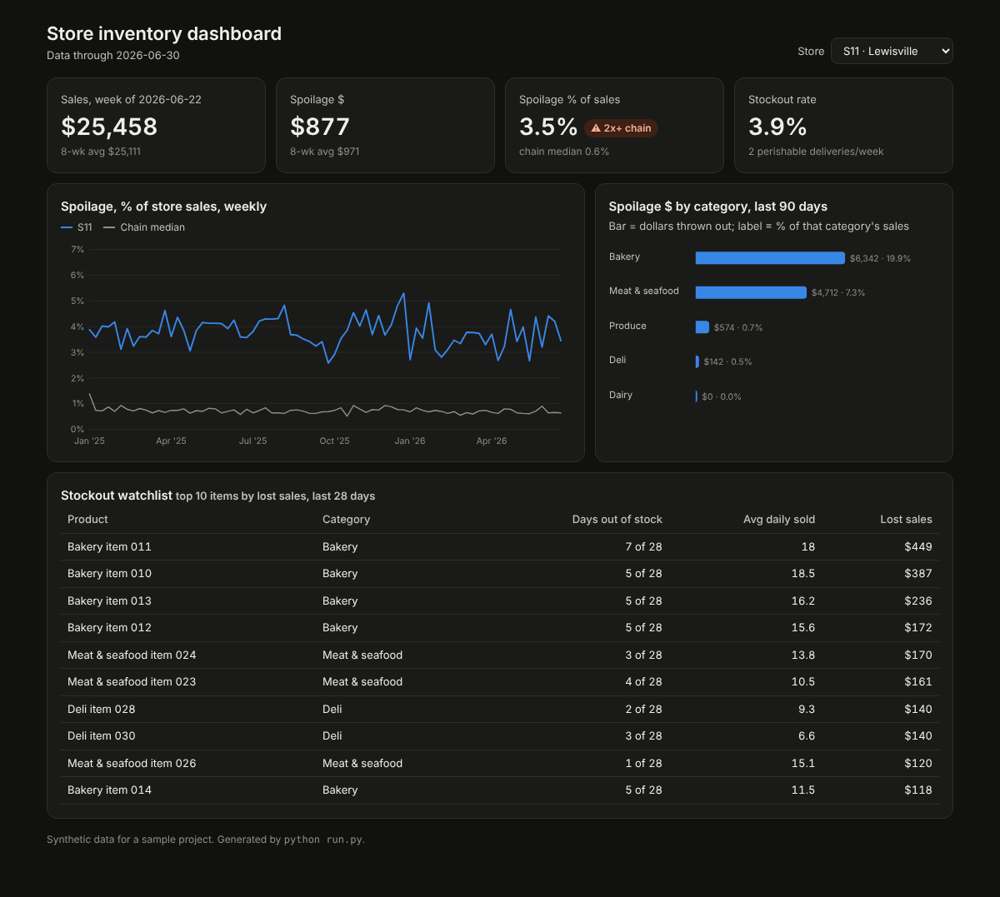
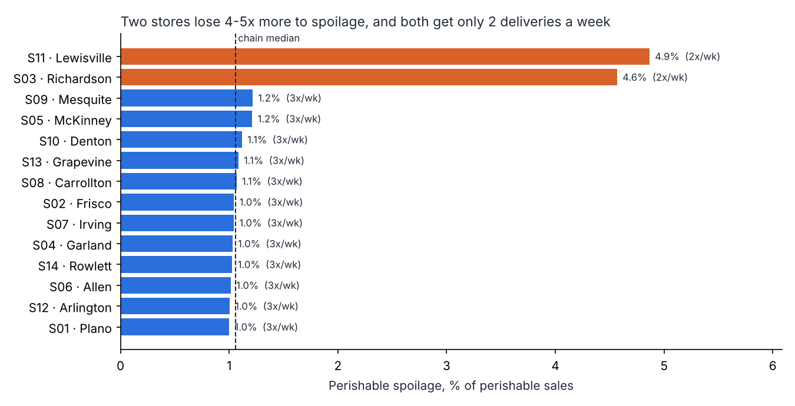

# Grocery inventory analytics

> **Personal project.** Models a hypothetical regional grocery chain. The company and all data are synthetic.

Three deliverables from one SQLite database of 18 months of store inventory:

1. **An inventory dashboard** store managers can open daily (one offline HTML file)
2. **An automated weekly Excel report** that replaces a manual build
3. **A spoilage investigation** that finds where money is thrown out and what fixing it is worth



## The finding

Stores **S03 (Richardson)** and **S11 (Lewisville)** lose 4.6–4.9% of perishable sales to spoilage, against a chain median of 1.1%. Both are the only stores getting perishable deliveries **twice a week instead of three times**. Bigger, less frequent orders sit on the shelf past expiry, mostly in bakery and meat.

Re-running the same 18 months of demand with a third weekly delivery cuts their spoilage by about 77%. That saves **~$68K per year** after an assumed $175 per extra delivery. Stockouts rise slightly, under 1 percentage point, which is the trade-off to watch.



## Run it

```bash
python -m venv .venv && source .venv/bin/activate
pip install -r requirements.txt
python run.py          # ~6 seconds
python -m pytest -q    # 4 tests
```

| Output (`outputs/`) | What it is |
| --- | --- |
| `dashboard.html` | Store picker, KPI tiles with flags, spoilage trend vs. chain median, category breakdown, stockout watchlist. Hover for details, light and dark mode. |
| `weekly_store_report.xlsx` | Summary with auto-flags, 12-week spoilage trend, stockout watchlist |
| `spoilage_findings.json`, `savings_estimate.csv`, `spoilage_by_store.csv` | Analysis results |
| `grocery.db` | The SQLite database. Open it in DB Browser for SQLite to explore the views. |

## How it works

- **`src/simulate.py`**: a real inventory model, not random numbers. For each store and product, each day it receives deliveries, sells **oldest stock first (FIFO)**, throws out expired stock, and orders enough to cover demand until the next truck. Spoilage *emerges* from shelf life and delivery timing. A test checks the stock balance (opening + received − sold − spoiled = closing) holds every day.
- **`sql/views.sql`**: `v_daily` (dollars per row), `v_store_week` (weekly KPIs), `v_stockout_hotspots`.
- **`src/spoilage_analysis.py`**: flags outliers with a robust z-score (median-based, so the outliers can't hide by inflating the average). It then tests the delivery-frequency hypothesis and runs the counterfactual on **identical demand**.
- **`src/weekly_report.py`**: SQL → formatted Excel with conditional formatting.
- **`src/dashboard.py`** + `dashboard_template.html`: embeds the data as JSON. Charts are hand-drawn SVG, with no internet or server needed.

## Design decisions

- **Why a counterfactual instead of "they spoil more, so fix it"?** Correlation isn't cause. Re-running the same demand with only the schedule changed isolates the effect.
- **Why subtract delivery cost?** A recommendation that ignores its own cost doesn't survive a VP's first question.
- **Why show stockouts next to spoilage?** You can always get spoilage to zero by stocking nothing. The real goal is less waste *without* empty shelves.

## Limitations

- Demand doesn't react to empty shelves (no substitution to other items).
- The $175 per delivery is an assumption. Change `EXTRA_DELIVERY_COST` in `src/spoilage_analysis.py`.
